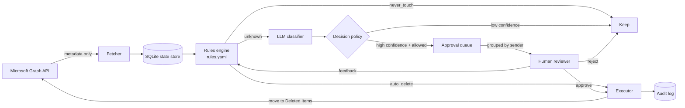

# Design Doc — Inbox Triage Agent

| | |
|---|---|
| **Author** | Jin (fekiee) |
| **Status** | Draft |
| **Last updated** | 2026-11-22 |

## 1. Problem statement

A personal Outlook.com (Hotmail) inbox has accumulated **~46,800 emails**, the large majority of them promotional/marketing. Manual cleanup is not realistic, and Outlook's built-in tools (Sweep, Rules) work one sender at a time and have no notion of confidence or review.

## 2. Goals

- Identify promotional/marketing email with **high precision** (deleting a legitimate email is far worse than keeping a promo).
- Require **human approval** before any destructive action, except for senders the user has explicitly pre-approved.
- **Learn** from approvals so each run needs less human input.
- Make every action **reversible and auditable**.
- Keep running costs close to zero.

### Non-goals

- Replacing Outlook's spam filter.
- Reading or summarising full email bodies.
- Unsubscribing automatically (possible future work — see §11).
- Multi-user / multi-tenant support.

## 3. Success metrics

| Metric | Target |
|---|---|
| Precision on promotional class (golden dataset) | ≥ 99% |
| False positives in production runs | 0 tolerated — any FP is a bug |
| Share of emails resolved by rules (no LLM) | ≥ 85% |
| Human decisions needed per run after first cleanup | < 20 senders |
| LLM cost of full initial cleanup | < €5 |

## 4. High-level architecture

### Components

1. **Auth** — Microsoft Entra ID app registration, OAuth 2.0 *device code flow* via MSAL, delegated permission `Mail.ReadWrite` only (least privilege). Token cache stored locally, never committed.
2. **Fetcher** — pages through the mailbox with Graph, requesting only: `id`, `from`, `subject`, `receivedDateTime`, `bodyPreview` (truncated), and `internetMessageHeaders` (for `List-Unsubscribe`). Handles pagination, `$batch`, and HTTP 429 throttling with exponential backoff. Idempotent: re-running skips already-fetched messages.
3. **State store** — SQLite via SQLAlchemy (portable to Postgres). Tables: `messages`, `senders`, `decisions`, `actions`, `runs`.
4. **Rules engine** — deterministic, driven by `rules.yaml` (*policy as config*):
   - `never_touch`: allowlist of domains/addresses (banks, family, employer, government, receipts). Always wins.
   - `auto_delete`: senders the user has approved previously.
   - Heuristics: `List-Unsubscribe` header, sender local-part patterns (`noreply`, `newsletter`, `marketing`, `promo`), subject keywords.
5. **LLM classifier** — only for senders the rules cannot resolve. Classification happens **per sender**, not per email (a sample of 3–5 subjects per sender). Returns structured output: `{category, confidence, reason}`. Behind a `Classifier` interface so the provider can be swapped (Claude API / local Ollama).
6. **Decision policy** — combines rule result + classifier output + confidence thresholds. Nothing is deleted without either an `auto_delete` rule or explicit human approval.
7. **Approval queue (human-in-the-loop)** — groups candidates by sender (`sender, count, sample subjects, reason, confidence`). v1: CLI (Typer + Rich) and CSV export/import. v3: lightweight web UI.
8. **Executor** — moves approved messages to **Deleted Items** (soft delete, recoverable). Supports `--dry-run` (default) and `undo <run_id>`.
9. **Feedback loop (memory)** — approvals add the sender to `auto_delete`; rejections add it to `never_touch`. This is what makes the system agentic: it improves with use.

## 5. Data model (initial)

- `messages(id, sender_id, subject, received_at, has_list_unsubscribe, preview, status)`
- `senders(id, address, domain, display_name, message_count)`
- `decisions(id, sender_id, source[rule|llm|human], category, confidence, reason, created_at)`
- `actions(id, run_id, message_id, action[move_to_deleted|restore], executed_at)`
- `runs(id, started_at, finished_at, mode[dry_run|execute], stats_json, llm_cost)`

## 6. Security & privacy

- **Data minimization** (GDPR principle): only metadata and a short preview are fetched and stored; no full bodies, no attachments.
- Only sender address + a few subjects are sent to the LLM; never the full preview of personal emails.
- Secrets in `.env` locally / GitHub Secrets in CI. In an enterprise setting: Azure Key Vault.
- `.gitignore` covers: `.env`, token cache, `*.db`, `exports/`, `logs/`.
- **No real email data in the repo.** Tests and demos use synthetic fixtures.
- Least-privilege scope (`Mail.ReadWrite`, delegated, single user).

## 7. Risks & mitigations

| Risk | Mitigation |
|---|---|
| Deleting a legitimate email (false positive) | Allowlist wins over everything; human approval; soft delete; `undo` |
| Graph throttling on 46k messages | Batching, backoff, resumable runs |
| LLM cost overrun | Rules first, classify per sender, cheapest model, Batch API, cost tracking per run with a hard budget |
| LLM hallucination / wrong category | Structured outputs, confidence threshold, LLM never deletes directly |
| Token leakage | Local token cache in ignored path; no tokens in logs |

## 8. Evaluation

- **Golden dataset**: ~200 senders labelled manually by the user (promo / keep).
- **Eval harness** reports precision, recall and false-positive rate for: rules only, LLM only, combined.
- Eval runs in CI against synthetic fixtures; against the real golden set locally.

## 9. Observability

- Structured logs (JSON) per run.
- Run report: emails fetched, resolved by rules, sent to LLM, queued, approved, moved, LLM tokens and cost.

## 10. Delivery plan

- **v1 — Rules + HITL (no LLM)**: auth, fetcher, SQLite, rules engine, CLI approval, executor with dry-run/undo, tests, CI.
- **v2 — LLM classifier + evaluation**: classifier interface, Claude implementation, decision policy, golden dataset, eval harness, cost tracking.
- **v3 — UX + automation**: web approval UI, scheduled runs, run reports.

## 11. Open questions / future work

- Scheduled execution host (local `launchd`, Mac Studio, or GitHub Actions with secrets) — to be decided in an ADR.
- Auto-unsubscribe via `List-Unsubscribe` (RFC 8058 one-click) — security implications to review.
- Local model (Ollama) as zero-cost provider — compare against Claude in eval harness.
